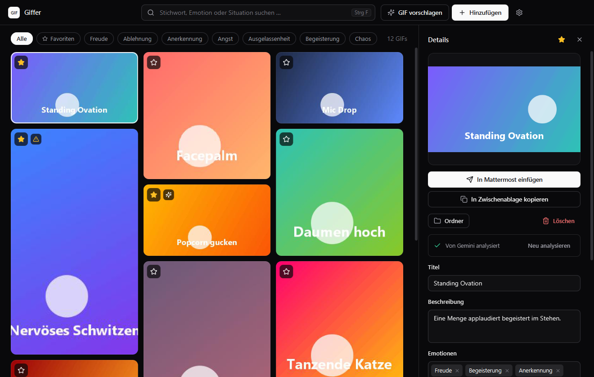

# Giffer

Sammle GIFs, lass sie von Google Gemini automatisch beschriften und finde später mit einem Stichwort
(„Applaus“, „Freude“, „wenn jemand zu spät kommt“) genau das richtige für den Moment. Ein Klick fügt es
in deinen Chat ein.



## Funktionen

- **GIFs per Link hinzufügen**: Der Link der Tenor-Seite genügt (auch Giphy, Imgur, direkte `.gif`-Links und die
  meisten Seiten mit GIF-Vorschau). Alternativ Dateien oder ganze Ordner, per Drag & Drop oder `Strg+V`.
- **Automatische Beschreibung**: Gemini schaut sich mehrere Bilder jedes GIFs an und liefert Titel, Emotionen,
  15–25 Stichwörter (Deutsch und Englisch) und eine Einsatzempfehlung. Alles lässt sich von Hand korrigieren.
- **GIF vorschlagen**: Nachricht oder Situation eintippen (zum Beispiel die Nachricht, auf die du antworten willst), und
  Gemini wählt aus deiner Bibliothek das passendste GIF aus, mit Begründung und zwei Alternativen. Dabei zählen Stimmung
  und Ton, nicht nur einzelne Wörter.
- **Schnelle Suche**: Live-Suche über alle Felder, Filter-Chips für die häufigsten Emotionen. `Enter` kopiert
  den besten Treffer.
- **Favoriten**: Mit dem Stern oben links auf jeder Karte markierst du deine liebsten GIFs (gelb gefüllt = Favorit).
  Der Chip **Favoriten** zeigt nur diese (auch zusammen mit der Suche), und bei gleich gutem Treffer stehen sie
  in der Suche und bei **GIF vorschlagen** vorne.
- **Animierte Vorschau**: Beim Überfahren spielt ein GIF ab, rechts im Detail-Panel sieht man es groß.
- **Ein Klick in deine Anwendung**: Der Papierflieger-Button legt das GIF in die Zwischenablage, holt eine
  Anwendung deiner Wahl (Mattermost, Discord, Teams, Browser …) nach vorn und fügt es mit `Strg+V` ein.
  Abgeschickt wird nichts, du kannst noch Text ergänzen.
- **Hell und Dunkel**, passend zu Windows.

## Download und Start

Giffer läuft unter **Windows 10/11**. Java muss nicht installiert sein.

1. [Giffer-windows-x64.zip herunterladen](../../releases/latest/download/Giffer-windows-x64.zip)
   (wird bei jedem Push auf `master` automatisch neu gebaut).
2. Zip entpacken, `Giffer.exe` starten.
3. Beim ersten Start unter ⚙ **Einstellungen → Gemini** den API-Key eintragen
   (kostenlos in [Google AI Studio](https://aistudio.google.com/apikey)) und „Verbindung testen“ klicken.

Windows SmartScreen warnt bei unbekannten, nicht signierten Programmen: „Weitere Informationen → Trotzdem ausführen“.

## Benutzung

| Aktion | So geht's |
| --- | --- |
| GIF hinzufügen | Link kopieren und `Strg+V` drücken, Link in die Suchleiste einfügen, Link oder Datei ins Fenster ziehen, oder **Hinzufügen** |
| Suchen | Tippen. `Strg+F` springt in die Suche, `Esc` leert sie |
| Passendes GIF zu einer Nachricht finden | **GIF vorschlagen** oder `Strg+G`, Text eingeben, `Strg+Enter` |
| Details ansehen und bearbeiten | Auf eine Karte klicken |
| Favorit markieren | Stern oben links auf der Karte oder oben im Detail-Panel. Der Chip **Favoriten** zeigt nur Favoriten |
| In die Zwischenablage kopieren | Doppelklick auf die Karte oder der Kopieren-Button |
| In eine Anwendung einfügen | Papierflieger-Button (auf der Karte beim Überfahren, oder im Detail-Panel) |
| Andere Anwendung wählen | `Umschalt` gedrückt halten beim Klick auf den Papierflieger |
| GIF in eine andere App ziehen | Karte mit der Maus aus dem Fenster ziehen |

Die Standard-Anwendung für den Papierflieger stellst du unter **Einstellungen → Einfügen** ein. Dort kannst du auch
festlegen, dass vor jedem Einfügen nachgefragt wird, und bei Browsern einen Fenstertitel-Filter setzen
(z. B. „Mattermost“), damit das richtige Fenster getroffen wird.

## Daten und Datenschutz

- Alles liegt in `%USERPROFILE%\Giffer`: `gifs\` (die Dateien), `thumbs\` (Vorschaubilder), `index.json`
  (Beschreibungen) und `settings.properties`. Wer das Projekt früher als „GIF Vault“ benutzt hat: der Ordner
  `GifVault` wird beim ersten Start automatisch umbenannt. Mit `-Dgiffer.home=<Ordner>` lässt sich ein anderer
  Speicherort wählen.
- Der **API-Key** liegt unverschlüsselt in `settings.properties` (alternativ wird die Umgebungsvariable
  `GEMINI_API_KEY` gelesen).
- Zur Analyse werden **vier Bilder pro GIF an die Gemini API von Google** gesendet. Im kostenlosen Kontingent
  darf Google diese Daten zur Verbesserung seiner Produkte nutzen, mit aktivierter Abrechnung nicht.
- Beim **Vorschlagen** werden deine eingegebene Nachricht sowie Titel, Emotionen, Stichwörter und Einsatzhinweise der GIFs an
  Gemini gesendet (keine Bilder). Bei sehr großen Bibliotheken werden höchstens 600 GIFs berücksichtigt, zuerst die, die
  Wörter mit der Nachricht gemeinsam haben, dann die neuesten. GIFs ohne Beschreibung bleiben außen vor.
- Das Einfügen in andere Anwendungen sendet nichts ins Netz. Es nutzt nur die Zwischenablage und die Tastenkombination
  `Strg+V` in dem Fenster, das du gewählt hast.
- HTTPS vertraut den Java-Zertifikaten **und** dem Windows-Zertifikatsspeicher, damit Giffer auch hinter
  Firmen-Proxys mit eigenem Zertifikat funktioniert.

## Aus dem Quellcode starten

Voraussetzung: **JDK 25 oder neuer** im `PATH`.

```bat
run.bat
```

Das lädt beim ersten Mal JavaFX 25 von Maven Central nach `lib\` (die Prüfsummen sind im Skript fest hinterlegt),
kompiliert alles und startet die App. In IntelliJ: Projekt öffnen, JDK 25+ wählen, die Run-Konfiguration „Giffer“
starten (`giffer.Main`; JavaFX liegt nach `scripts\download-javafx.ps1` in `lib\`).

Eine eigene, eigenständige Windows-Version bauen:

```powershell
.\scripts\package.ps1            # erzeugt dist\Giffer\Giffer.exe und dist\Giffer-windows-x64.zip
```

## Automatische Builds

`.github/workflows/release.yml` läuft bei jedem Push auf `master`: JDK 25 installieren, `scripts/package.ps1`
ausführen und die Zip-Datei als Release **latest** veröffentlichen (das vorherige Release wird ersetzt). Der Link
`releases/latest/download/Giffer-windows-x64.zip` zeigt deshalb immer auf den neuesten Stand. Dafür braucht das
Repository keine zusätzlichen Secrets, nur die Standardrechte des Workflows (`contents: write`).

## Aufbau

```
src/giffer/       Quellcode (Paket giffer)
  GifferApp       Fenster, Raster, Suche, Zusammenspiel
  *Workflow       Import, Analyse und Einfügen als eigene Abläufe
  *Dialog         Einstellungen, Hinzufügen, Anwendung wählen, Bestätigen
  GifLibrary      Speicher und Suche   |  GifDecoder, AnimationCache   GIF-Frames und Animation
  SuggestionWorkflow Nachricht zu GIF-Auswahl (Gemini, nur Texte)   |   GifPreview   animierte Vorschau
  GeminiClient    Gemini API           |  LinkImporter                 Tenor, Giphy, Imgur, direkte Links
  PasteTarget     Fenster auflisten und einfügen (PowerShell) |  TlsTrust   Windows-Zertifikate
res/app.css       Design (shadcn-inspiriert, hell und dunkel)
scripts/          JavaFX laden, Windows-App bauen
packaging/        App-Icon
```

## Hinweise

- **Nur Windows**: Das Einfügen nutzt Windows PowerShell, und die gebündelten JavaFX-Bibliotheken sind die für Windows.
- Der integrierte Titelbalken nutzt eine JavaFX-Funktion, die in JavaFX 25 noch als Vorschau gilt. Fehlt sie, fällt die
  App auf den normalen Fensterrahmen zurück.
- Gemini wird über `generateContent` angesprochen. Google nennt diese Schnittstelle inzwischen „legacy“, hat sie aber
  nicht abgekündigt.
- Die Seitenstruktur von Tenor und Giphy ist nicht garantiert. Sollte ein Link einmal nicht funktionieren, hilft meist
  der direkte Link auf die `.gif`-Datei.

## Verwendete Software

[JavaFX](https://openjfx.io) (GPLv2 + Classpath Exception), Icons aus [Lucide](https://lucide.dev) (ISC),
Schrift Segoe UI (Teil von Windows).
